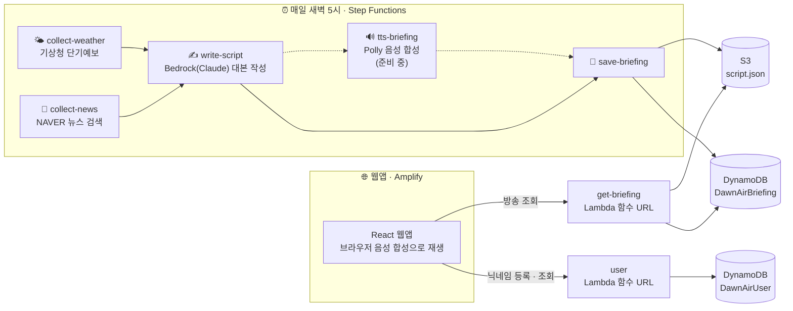

<div align="center">

# 🌅 DawnAir · 던에어

**오늘 아침, 귀로 듣는 브리핑**

매일 새벽 AI가 날씨와 뉴스를 모아 라디오 대본을 쓰고,<br>
출근길에 내 이름을 불러 주며 오늘의 소식을 들려주는 모닝 브리핑 웹앱이에요.

[](https://www.dawnair.site)
[](https://www.figma.com/design/jwxaZM0g5ETLebqh9678vd)


</div>

---

## ✨ 주요 기능

| | 기능 | 설명 |
|---|---|---|
| 🎙️ | **AI 라디오 브리핑** | 매일 새벽 5시, 날씨와 뉴스로 10~15분짜리 방송 대본을 자동으로 만들어요 |
| 👋 | **내 이름을 불러 주는 인사** | "안녕하세요, ○○님. 2026년 10월 17일 토요일입니다." 사용자마다 다른 오프닝 |
| 📰 | **배경까지 알려 주는 뉴스** | 꼭지마다 핵심 요약 · 배경 · 왜 중요한가 · 원문 기사 링크 |
| 🌤️ | **날씨 · 옷차림** | 기상청 예보로 기온, 비 소식, 오늘의 옷차림을 알려 줘요 |
| 📜 | **대본 보기** | 방송 전문을 읽고, 원하는 꼭지부터 바로 들을 수 있어요 |
| 📅 | **지난 방송** | 달력에서 날짜를 골라 다시 듣기 |
| 🔆 | **방송 화면** | 목소리에 맞춰 움직이는 태양(orb), 챕터별 진행바, 재생 속도 조절 |
| 👤 | **간편 로그인** | 비밀번호 없이 닉네임만 정하면 그 기기에서 계속 로그인 상태 |
| 📱 | **앱처럼 설치** | 홈 화면에 추가(PWA)해서 앱처럼 사용, 라이트/다크 모드 |

---

## 🏗️ 아키텍처



### 하루 흐름

1. **수집 (병렬)** — 기상청에서 서울 날씨를, 네이버 뉴스에서 카테고리별 주요 사건과 기사 본문을 모아요.<br>
   여러 언론사가 함께 다룬 사건일수록 중요하다고 보고, 가장 많이 보도된 사건이 *오늘의 톱뉴스*가 돼요.
2. **대본 작성** — Bedrock(Claude)이 뉴스를 편성하고 라디오 원고를 써요.<br>
   오프닝 인사는 `"안녕하세요, {nickname}님. …"` 처럼 이름 자리를 비워 두고, 재생할 때 사용자 닉네임으로 채워요.<br>
   대본은 하루에 하나만 만들고 모든 사용자가 같이 써요.
3. **저장** — 대본 전문은 S3에, 목록·메타데이터는 DynamoDB에 저장해요.
4. **듣기** — 웹앱이 대본을 받아 브라우저 음성 합성(`speechSynthesis`)으로 문장 단위로 읽어요.

---

## 📁 저장소 구조

```
dawnair/
├─ frontend/                 React 웹앱 (Amplify 배포)
│  ├─ public/                manifest.json · sw.js · 아이콘 (PWA)
│  └─ src/
│     ├─ api/                briefing.js (방송 조회 · 대본→재생 타임라인) · user.js (사용자) · mock.js
│     ├─ components/         Logo · BroadcastOrb · Navigation · PlayerDock · BriefingItems · Nickname 화면들
│     ├─ context/            PlayerContext (앱 전체가 함께 쓰는 플레이어) · UserContext (로그인 상태)
│     ├─ hooks/              useTheme · useAsync · useListened
│     ├─ pages/              홈 · 대본 보기 · 지난 방송 · 방송 화면
│     ├─ styles/             tokens.css (디자인 토큰 · 라이트/다크) · global.css
│     └─ utils/              date.js (한국 시간 기준) · press.js (언론사 도메인 → 이름)
├─ lambda/                   AWS Lambda 함수 (Python 3.12)
│  └─ state-machine-with-tts.json   Step Functions 정의 (Polly 단계 포함 버전)
└─ amplify.yml               Amplify 빌드 설정 (frontend → dist)
```

---

## 🚀 프론트엔드 실행

```bash
cd frontend
npm install
npm run dev        # http://localhost:5173
```

| 명령 | 내용 |
|---|---|
| `npm run dev` | 개발 서버 |
| `npm run build` | 배포용 빌드 (`dist/`) |
| `npm run preview` | 빌드 결과 미리보기 |

### 환경 변수

`frontend/.env.example`을 `.env`로 복사해서 채워요. **비워 두면 목업 데이터로 동작**해서 백엔드 없이도 화면을 볼 수 있어요.

| 변수 | 내용 | 비어 있으면 |
|---|---|---|
| `VITE_API_BASE_URL` | `get-briefing` Lambda 함수 URL | `src/api/mock.js` 목업 방송 |
| `VITE_USER_API_URL` | `user` Lambda 함수 URL | 서버 없이 브라우저에만 닉네임 저장 |

> 💡 배포 환경은 Amplify 콘솔 → **호스팅 → 환경 변수**에 같은 이름으로 넣고 다시 배포해요. (빌드할 때 코드에 들어가요)

---

## ☁️ 백엔드 (AWS Lambda)

| 함수 | 역할 | 주요 환경 변수 |
|---|---|---|
| `collect-weather` | 기상청 단기예보로 서울 날씨 수집 · 요약 | `KMA_SERVICE_KEY` |
| `collect-news` | 네이버 뉴스 검색 → 사건 묶기 → 톱뉴스 선정 → 본문 수집 | `NAVER_CLIENT_ID`, `NAVER_CLIENT_SECRET`, `BUCKET` |
| `write-script` | Bedrock으로 날씨 멘트 · 뉴스 편성 · 오프닝/클로징 작성 | `LLM_BASE_URL`, `LLM_API_KEY`, `MODEL_ID` |
| `tts-briefing` | Polly로 방송 mp3 생성 *(준비 중)* | `BUCKET`, `VOICE_ID` |
| `save-briefing` | 대본 → S3, 메타데이터 → DynamoDB | `BUCKET`, `TABLE` |
| `get-briefing` | 웹앱 조회 API (함수 URL) | `BUCKET`, `TABLE` |
| `user` | 기기별 닉네임 등록 · 조회 API (함수 URL) | `TABLE` |

> `aitest.py`, `sgu-20260918-bedrock-test.py`는 LLM 게이트웨이 연결 테스트용이에요.

### API

<details>
<summary><b>get-briefing</b> — 방송 조회</summary>

| 요청 | 응답 |
|---|---|
| `GET {URL}` | 오늘 방송 (아직 없으면 가장 최근 방송) |
| `GET {URL}?date=2026-10-17` | `{ meta, script }` · 없으면 `404` |
| `GET {URL}?list=1` | `{ items: [{ date, date_label, title, duration, segmentCount }] }` |

`script.opening`

```json
{
  "greeting": "안녕하세요, {nickname}님. 2026년 10월 17일 토요일입니다.",
  "body": "오늘 아침 주요 뉴스를 전해드리겠습니다. …",
  "speech": "안녕하세요. 2026년 10월 17일 토요일입니다. 오늘 아침 주요 뉴스를 …"
}
```

`greeting`의 `{nickname}`은 웹앱이 재생할 때 닉네임으로 바꿔요. `speech`는 닉네임 없는 공용 버전이에요.

</details>

<details>
<summary><b>user</b> — 사용자 (기기별 닉네임)</summary>

| 요청 | 응답 |
|---|---|
| `POST {URL}` body `{ deviceId, nickname }` | `{ user }` 등록 / 닉네임 변경 |
| `GET {URL}?deviceId=<uuid>` | `{ user }` 조회 + 마지막 접속 시간 갱신 · 없으면 `404` |

- 비밀번호 없이 **브라우저(기기)마다 만든 UUID**를 사용자 ID로 써요.
- 기기를 바꾸거나 브라우저 데이터를 지우면 새 사용자로 등록돼요.
- DynamoDB `sgu-20260918-DawnAirUser` (파티션 키 `deviceId`)
  — `nickname`, `userAgent`, `createdAt`, `updatedAt`, `lastSeenAt`

</details>

---

## 🎨 디자인

- **디자인 토큰** — `src/styles/tokens.css`의 CSS 변수는 피그마 변수 이름과 1:1로 맞췄어요. (`bg/page` → `--bg-page`)<br>
  색을 바꿀 때는 피그마 변수와 `tokens.css`를 같이 바꿔 주세요.
- **라이트 / 다크** — 기본은 OS 설정을 따르고, 상단의 해/달 버튼으로 바꿀 수 있어요.
- **반응형**

  | 폭 | 레이아웃 |
  |---|---|
  | 1024px 이상 | 데스크톱 — 2단 레이아웃, 상단 메뉴 + 하단 전체 폭 재생바 |
  | 768 ~ 1023px | 태블릿 — 1단 레이아웃 |
  | 767px 이하 | 모바일 — 하단 탭바 + 미니 플레이어 |

---

## 📦 배포 (AWS Amplify)

- `main` 브랜치에 병합되면 Amplify가 `amplify.yml`로 자동 빌드 · 배포해요.
- 도메인: **https://www.dawnair.site**
- Lambda 함수 URL의 **CORS 허용 오리진**에 서비스 도메인을 넣어야 웹앱에서 호출할 수 있어요.

> ⚠️ **주소 직접 접속(새로고침) 대비 리라이트 규칙**<br>
> Amplify 콘솔 → *Rewrites and redirects* 에 추가해 주세요. 없으면 `/history` 같은 주소로 바로 들어갈 때 404 상태가 돼요.
>
> | Source | Target | Type |
> |---|---|---|
> | `</^[^.]+$\|\.(?!(css\|gif\|ico\|jpg\|js\|png\|txt\|svg\|woff\|woff2\|ttf\|map\|json\|webmanifest\|mp3)$)([^.]+$)/>` | `/index.html` | `200 (Rewrite)` |

---

## 🗺️ 앞으로

- [ ] **Polly 음성 적용** — 지금은 브라우저 음성 합성으로 읽어요. mp3로 바꾸면 목소리가 일정해지고 진행바가 정확해져요.
- [ ] **사용자 취향 맞춤** — 관심 카테고리, 지역 설정 등 사용자별 방송
- [ ] **새 방송 자동 반영** — 앱을 켜 둔 채 날짜가 바뀌어도 새 방송을 다시 불러오기
